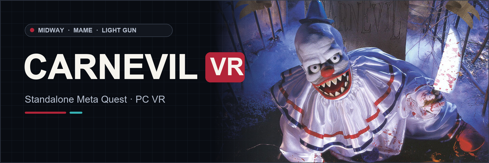

<div align="center">



# CarnEvil VR
### Midway Arcade Light-Gun Horror · Standalone Meta Quest & PC VR

[](https://github.com/vr4all-standalone/carnevil-vr/releases/latest)
[](#installation-meta-quest)
[](#your-game-files)

**[⬇️ Quest APK](https://github.com/vr4all-standalone/carnevil-vr/releases/latest/download/carnevil-vr-quest.apk)** · **[🖥️ PC VR ZIP](https://github.com/vr4all-standalone/carnevil-vr/releases/latest/download/carnevil-vr-pcvr.zip)** · **[🎮 Controls](#controls)**

[Checksums](https://github.com/vr4all-standalone/carnevil-vr/releases/latest/download/SHA256SUMS.txt) · [Complete source](https://github.com/vr4all-standalone/carnevil-vr/releases/latest/download/carnevil-vr-source.zip) · [All releases](https://github.com/vr4all-standalone/carnevil-vr/releases)

**[🌐 VR4ALL — Standalone VR Mod Installer](https://github.com/vr4all-standalone/vr4all-standalone)**

[☕ Donate to VR4ALL](https://ko-fi.com/vr4all)

</div>

---

## Update v0.1.4

- Shared wide VR4ALL setup panel, with validated automatic entry and manual Play.
- Full player-colored Arcade body and grip, with original grey screws and lens details. P1 red / P2 blue follow player identity across hand swaps.
- New gun angle 0 matches the old -10-degree pose. Legacy angles reset once; later choices and other settings persist.

## Overview

**CarnEvil VR** brings Midway's arcade horror light-gun game to **Meta Quest 3 / 3S** and **Windows PC VR**. MAME 0.289 runs the original game; the OpenXR host rebuilds its characters and scenery in stereo, and your tracked controllers become the lightguns.

The v0.1.2 update was tested and accepted on Quest 3S. It adds adjustable scene size and stereo depth, a HUD that scales with the scene, and corrected native impact alignment. Earlier accepted features include scenery depth, smooth gameplay audio, laser occlusion, P2 joining, muzzle flash and smoke. Windows PCVR builds and automated OpenGL tests pass; PC headset profiles and every game route have not been exhaustively tested.

The [header artwork](readme-banner.md) uses the original Midway promotional art in the shared VR4ALL banner layout.

## Key VR Features

- Stereo 3D characters and tracked lightguns.
- **Depth 3D backgrounds by default**, with Original available in the VR menu.
- Solo hand switching and two-player play with reversible P1/P2 hand assignment.
- Native shot-aligned lasers, recoil, muzzle flash, drifting smoke and adjustable haptics.
- **3D strength and Stereo separation**, both defaulting to **1.25×**.
- Health and ammo HUD scale with 3D strength; native impact sparks follow the scene depth.
- Arcade and Zapper gun options, gun angle/size and world-size controls.
- Three reload modes, native Service controls and the shared VR4ALL startup/controller guide.

## Downloads

Open [Releases](https://github.com/vr4all-standalone/carnevil-vr/releases/latest) and choose:

| File | Use |
| --- | --- |
| `carnevil-vr-quest.apk` | Standalone Quest installation |
| `carnevil-vr-pcvr.zip` | Portable Windows OpenXR build |
| `carnevil-vr-source.zip` | Complete matching port source, pinned MAME Git bundle, SDL/OpenXR sources and build instructions |
| `SHA256SUMS.txt` | Download integrity checks |

The complete buildable source is attached to the release. GitHub's automatically generated “Source code” archives contain this project page; use **carnevil-vr-source.zip** to build the mod.

## Your Game Files

The ROM ZIP contains `carnevil1_9.u32`, `sound102.u95` and `486_carnevil.u96`. The matching CHD overall SHA1 is `5cffb0de63ad36eb01c5951bab04d3f8a9e23e16`. No NAOMI BIOS is required. **No game files are included or linked.**

<a id="quest-setup"></a>
## Installation (Meta Quest)

1. Sideload `carnevil-vr-quest.apk`.
2. Put your own CarnEvil v1.0.3 game files on the headset:

```text
Download/carnevil.zip
Download/carnevil/carnevil.chd
```

3. Keep the ROM ZIP packed. Open CarnEvil VR, grant file access on its setup screen and keep the Touch controllers awake.
4. Start the game. The controller guide appears after the VR4ALL splash.

<a id="windows-pcvr-setup"></a>
## Installation (PC VR)

Extract `carnevil-vr-pcvr.zip`, enable your PC OpenXR runtime and connect the headset. Put your own files at `roms/carnevil.zip` and `roms/carnevil/carnevil.chd` beside the executable, then run **Run CarnEvil VR.cmd**. To use another ROM directory, run `launch-pcvr.ps1 -RomDirectory D:\MyRoms`.

Settings, NVRAM and disk differences are kept in `userdata/`.

## Controls

| Control | Action |
| --- | --- |
| A / X | Start or continue P1 / join P2, including credit insertion |
| Either trigger, solo | Switch the active gun to that hand and shoot |
| Both players joined | P1 left / P2 right by default; reversible in settings |
| B / Y | Pump/reload; either hand works in solo |
| Left Menu | Pause and open VR settings |
| Left stick click | Recenter |
| Right stick click | Toggle laser |
| Grip, then stick up/down | World size |
| Grip, then stick left/right | Gun size |

Squeeze grip with the stick at rest first. Reload options are Button pump, Shoot off-screen and Point off-screen. The VR menu also provides **3D strength**, **Stereo separation**, **How to play**, gun/haptics options and **Open Service Menu**.

In Service, use the stick to move, trigger/A/X to select and B/Y to go back. Right stick click toggles gun-test controls; in that mode triggers/pumps reach the native guns and A/X sends native Start. The VR menu's Service controls row offers the same toggle.

## Depth 3D and Known Limits

**Menu → Background → Depth 3D** reconstructs scenery from the game's original depth data. **Depth 3D is the default. Original** remains available and your saved choice is respected. Flat or unusable depth falls back automatically.

**3D strength** ranges from 1–2× in 0.25 steps. **Stereo separation** offers 1, 1.25, 1.5, 2, 3, 4 and 5.25×. Both default to **1.25×**; existing valid saved choices are kept. Health and bullet counts scale with strength, while VR menus and tracked guns keep their physical size. Native hit effects now line up with the scene and laser. The Gun selector offers **Arcade / Zapper**; an old third choice safely falls back to Arcade.

The arcade camera only supplies visible scenery. Leaning may reveal gaps, with the original image behind them; this is not a complete 360° world. Wider view is unavailable. Boot and native diagnostics use a raster panel. This release retains the physically tested APK's internal `0.1.2-dev` label (Android version code 3).

## Source and Credits

Download **carnevil-vr-source.zip** from the release for the complete source and build instructions. It includes the pinned MAME source bundle, patches, exact SDL/OpenXR source snapshots, dependency hashes, licenses and validation notes. The port uses GPL-2.0-or-later; individual upstream files retain their original notices.

See [CREDITS.md](CREDITS.md) and [LICENSE](LICENSE). CarnEvil and its original game content belong to their respective owners. This community port is not an official MAME or Midway product.
